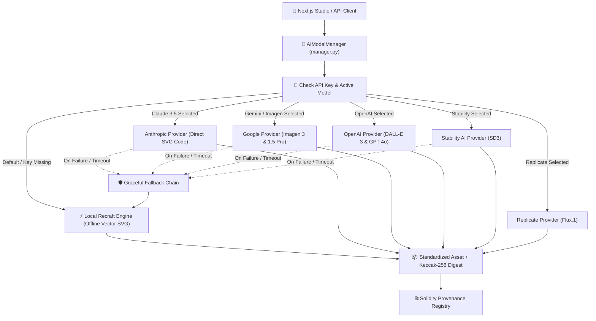

# 🤖 AI Models Manager & Unified Gateway (`ai_models/`)

A production-grade, multi-provider AI model orchestration gateway built specifically for the **Recraft AI Platform**.
It allows seamless switching, configuring, routing, and fallback across **Anthropic Claude**, **Google Gemini**, **OpenAI (ChatGPT & DALL-E 3)**, **Stability AI**, **Replicate (Flux.1)**, and the **Local Recraft Vector Engine**.

---

## 📑 Table of Contents

1. [Architecture Overview](#-architecture-overview)
2. [Folder Structure](#-folder-structure)
3. [Supported AI Providers & Model Matrix](#-supported-ai-providers--model-matrix)
4. [Quick Start & API Keys Configuration](#-quick-start--api-keys-configuration)
5. [How Routing & Automatic Fallback Works](#-how-routing--automatic-fallback-works)
6. [Python SDK Usage (Direct Import)](#-python-sdk-usage-direct-import)
7. [REST API Endpoints & cURL Examples](#-rest-api-endpoints--curl-examples)
8. [Frontend Studio Integration](#-frontend-studio-integration)
9. [How to Add a New AI Model](#-how-to-add-a-new-ai-model)
10. [Automated Verification & Tests](#-automated-verification--tests)
11. [Troubleshooting & FAQ](#-troubleshooting--faq)

---

## 🏗️ Architecture Overview

The gateway acts as an intelligent abstraction layer between user prompts and underlying generative AI backends:



---

## 📁 Folder Structure

```
ai_models/
├── config.json                     # Active model choices, provider settings, fallback priority
├── .env.example                    # Sample environment variables for all API keys
├── manager.py                      # Master AIModelManager class & fallback router
├── registry.py                     # Catalog of models, metadata, capabilities, context & pricing
├── test_providers.py               # Standalone test runner for routing & fallback simulation
├── README.md                       # Comprehensive guide (this document)
└── providers/
    ├── __init__.py                 # Package exports
    ├── base.py                     # BaseAIProvider abstract interface
    ├── local_recraft_provider.py   # Algorithmic Recraft SVG Vector Engine (Offline/Local)
    ├── anthropic_provider.py       # Claude 3.5 Sonnet (Direct SVG coding & design prompt engineering)
    ├── gemini_provider.py          # Google Gemini 1.5 Pro & Imagen 3 (High-res image generation)
    ├── openai_provider.py          # OpenAI DALL-E 3 (Image synthesis) & GPT-4o (Prompt expander)
    ├── stability_provider.py       # Stability AI (Stable Diffusion 3 & SDXL)
    └── replicate_provider.py       # Replicate (Black Forest Labs Flux.1 Schnell)
```

---

## 🚀 Supported AI Providers & Model Matrix

| Provider | Model ID | Output Format | Recommended Use Case | Requires API Key? |
|---|---|---|---|---|
| **Recraft Local** | `recraft-v3-vector` | Pure Scalable `.svg` & `.png` | Logos, icons, brand illustrations, infinite zoom | ❌ No (100% Free / Offline) |
| **Anthropic Claude** | `claude-3-5-sonnet-20241022` | Standalone SVG Markup | Writing clean, semantic, editable SVG code directly | `ANTHROPIC_API_KEY` |
| **Anthropic Claude** | `claude-3-5-haiku-20241022` | Text / Prompt Refinement | Sub-second prompt expansion & keyword autocomplete | `ANTHROPIC_API_KEY` |
| **Google Gemini** | `imagen-3.0-generate-002` | High-res PNG | Photorealism, product shots, accurate text rendering | `GEMINI_API_KEY` |
| **Google Gemini** | `gemini-1.5-pro` | Multimodal / Text | Brand guidelines digestion & multimodal critique | `GEMINI_API_KEY` |
| **OpenAI ChatGPT** | `dall-e-3` | High-res PNG | Highly detailed scenes and stylized 3D graphics | `OPENAI_API_KEY` |
| **OpenAI ChatGPT** | `gpt-4o` | Text / JSON | Creative prompt ideation and color theory advice | `OPENAI_API_KEY` |
| **Stability AI** | `stable-diffusion-v3-medium` | PNG | Fast artistic textures, posters, and game concept art | `STABILITY_API_KEY` |
| **Replicate** | `black-forest-labs/flux-schnell` | WebP / PNG | Sub-second generation speed for rapid iteration | `REPLICATE_API_TOKEN` |

---

## ⚙️ Quick Start & API Keys Configuration

### 1. Configure Keys
Copy [`ai_models/.env.example`](file:///home/InnoX107/Documents/Recraft/ai_models/.env.example) to `.env` or set them in your environment:

```bash
# Add keys for any external provider you want to enable:
export ANTHROPIC_API_KEY="sk-ant-api03-..."
export GEMINI_API_KEY="AIzaSy..."
export OPENAI_API_KEY="sk-proj-..."
export STABILITY_API_KEY="sk-..."
export REPLICATE_API_TOKEN="r8_..."
```

### 2. Configure Defaults in [`config.json`](file:///home/InnoX107/Documents/Recraft/ai_models/config.json)
You can set your default image engine, default prompt LLM, and fallback chain:
```json
{
  "active_image_provider": "recraft_local",
  "active_llm_provider": "claude",
  "fallback_chain": ["recraft_local", "gemini", "openai", "stability", "replicate"]
}
```

> **🛡️ Zero-Crash Policy**: You do **not** need all keys! If any key is omitted, the platform remains fully functional by automatically falling back to `recraft_local`.

---

## 🛡️ How Routing & Automatic Fallback Works

When a generation request arrives:
1. **Target Selection**: The manager determines the requested provider (e.g. `claude`).
2. **Credential Validation**: It checks if the required environment variable exists.
3. **Execution**: The provider generates the artwork.
4. **Graceful Fallback**: If an API key is missing, network is unreachable, or a provider rate-limits, the manager catches the error, logs a warning, and immediately attempts the next provider in `fallback_chain`.
5. **Guaranteed Return**: `recraft_local` sits as the ultimate safety net, ensuring the user always receives a valid, styled SVG asset without ever seeing a 500 error screen.

---

## 🐍 Python SDK Usage (Direct Import)

You can import and use `ai_manager` directly in any backend module, script, or notebook:

```python
from ai_models.manager import ai_manager

# 1. Generate using the default active model
artwork = ai_manager.generate_artwork(
    prompt="cyberpunk robot cat in sleek vector style",
    style_preset="vector_art",
    aspect_ratio="1:1",
    palette_colors=["#FF5C00", "#1A1A24", "#00E5FF"]
)
print("SVG Markup:", artwork["svg_content"])
print("Content Hash:", artwork["content_hash"])

# 2. Specifically route to Anthropic Claude 3.5 Sonnet (Direct SVG generation)
claude_art = ai_manager.generate_artwork(
    prompt="isometric 3d neon glass cube",
    style_preset="3d_render",
    preferred_provider="claude"
)

# 3. Enhance a short prompt using Claude / Gemini / GPT-4o
refined_prompt = ai_manager.enhance_prompt(
    prompt="red fox badge",
    style_preset="icon_set",
    preferred_llm="claude"
)
print("Refined:", refined_prompt)

# 4. List available models & status
all_models = ai_manager.list_all_models()
for m in all_models:
    print(f"{m['name']} -> Ready: {m['has_api_key']}")
```

---

## 🌐 REST API Endpoints & cURL Examples

All model management capabilities are exposed via the Django REST backend:

### 1. List All Configured Providers
```bash
curl -X GET http://127.0.0.1:8000/api/ai/models/
```
**Response:**
```json
{
  "active_image_provider": "recraft_local",
  "active_llm_provider": "claude",
  "providers": [
    {
      "id": "recraft_local",
      "name": "Recraft V3 Vector Engine",
      "type": "vector",
      "has_api_key": true,
      "requires_api_key": false,
      "is_active_image": true
    },
    {
      "id": "claude",
      "name": "Anthropic Claude",
      "type": "svg_coder_and_llm",
      "has_api_key": true,
      "is_active_llm": true
    }
  ]
}
```

### 2. Switch the Active Model Globally
```bash
curl -X POST http://127.0.0.1:8000/api/ai/models/ \
  -H "Content-Type: application/json" \
  -d '{
    "active_image_provider": "gemini",
    "active_llm_provider": "claude"
  }'
```

### 3. Generate Artwork with a Specific Provider
```bash
curl -X POST http://127.0.0.1:8000/api/ai/generate/ \
  -H "Content-Type: application/json" \
  -d '{
    "prompt": "geometric red fox shield badge",
    "style_preset": "icon_set",
    "aspect_ratio": "1:1",
    "palette_colors": ["#FF5C00", "#10B981", "#111827"],
    "provider": "claude"
  }'
```

### 4. Expand a Prompt with an LLM
```bash
curl -X POST http://127.0.0.1:8000/api/ai/enhance-prompt/ \
  -H "Content-Type: application/json" \
  -d '{
    "prompt": "space station minimal icon",
    "style_preset": "vector_art",
    "llm": "claude"
  }'
```

---

## 🎨 Frontend Studio Integration

In the Recraft Studio ([`frontend/src/app/app/page.tsx`](file:///home/InnoX107/Documents/Recraft/frontend/src/app/app/page.tsx)), users can switch AI engines dynamically inside the bottom prompt dock:

1. Click the **Cyan AI Model Pill** (e.g. `Recraft V3 Vector`).
2. Select your desired engine:
   * **Recraft V3 Vector** (Clean geometric SVG curves)
   * **Anthropic Claude 3.5** (Code-synthesized SVG)
   * **Google Imagen 3 / Gemini** (Photorealistic high-res)
   * **ChatGPT / DALL-E 3** (Detailed scene composition)
   * **Stability AI SD3** (Diffusion textures)
   * **Replicate Flux.1** (Sub-second speed)
3. Hit **Recraft** (`Enter`) — the backend automatically dispatches the job to that provider and attaches an on-chain Keccak-256 signature for ownership proof.

---

## ➕ How to Add a New AI Model

Adding a new model (e.g. DeepSeek, Mistral, Midjourney API, or local Ollama) takes just 3 steps:

### Step 1: Create a Provider Class
Create `ai_models/providers/my_new_provider.py`:
```python
from .base import BaseAIProvider
from typing import Dict, Any, Optional

class MyNewProvider(BaseAIProvider):
    def __init__(self, api_key: Optional[str] = None):
        super().__init__(api_key=api_key)

    def generate_image(self, prompt: str, style_preset: str = "vector_art", **kwargs) -> Dict[str, Any]:
        # Call your model API here
        return {
            "svg_content": "<svg>...</svg>",
            "image_url": "https://...",
            "content_hash": "0x...",
            "prompt_hash": "0x...",
            "model_version": "my-model-v1",
            "provider": "My Provider"
        }

    def enhance_prompt(self, prompt: str, style_preset: str = "vector_art") -> str:
        return f"{prompt}, enhanced"
```

### Step 2: Register in `ai_models/providers/__init__.py`
Export your new class in `__all__`.

### Step 3: Register in `ai_models/manager.py` & `config.json`
Add an instance to `self.providers["my_provider"] = MyNewProvider()` and add it to `config.json`. Done! It is instantly available in the API and UI.

---

## 🧪 Automated Verification & Tests

Run the test suite to verify routing, LLM prompt enhancement, and fallback mechanisms:

```bash
# Activate virtual environment
source backend/venv/bin/activate

# Run the AI manager test runner
python ai_models/test_providers.py
```

Expected output:
```
==================================================
🤖 TESTING AI MODEL MANAGER & MULTI-PROVIDER GATEWAY
==================================================

[1] Discovered 6 AI Providers:
  • Recraft V3 Vector Engine (recraft_local) - Status: READY
  • OpenAI (ChatGPT & DALL-E 3) (openai) - Status: NO KEY (Fallback available)
  • Anthropic Claude (claude) - Status: NO KEY (Fallback available)
  • Google Gemini & Imagen (gemini) - Status: NO KEY (Fallback available)
  • Stability AI (stability) - Status: NO KEY (Fallback available)
  • Replicate (Flux.1 & Community) (replicate) - Status: NO KEY (Fallback available)

[2] Testing Prompt Enhancement:
  Original: 'robot cat'
  Enhanced: 'robot cat, styled by Claude 3.5 in vector_art vector curves'

[3] Testing Generation Routing (Local Recraft Vector Engine):
  Routed to: recraft_local
  SVG Produced: True
  Content Digest: 0xc1bdc63458a106fd...

[4] Testing Graceful Provider Fallback:
  Requested: 'openai' -> Safely Routed to: recraft_local
  Status: SUCCESS (Zero crashes)

==================================================
✨ ALL AI MODEL MANAGER ROUTING TESTS PASSED!
==================================================
```

---

## ❓ Troubleshooting & FAQ

#### Q: What happens if I don't supply any API keys?
**A:** Everything still works! The system defaults to `recraft_local`, which generates native, scalable SVG vector designs and renders PNG previews completely offline.

#### Q: How does Claude generate SVGs?
**A:** Claude 3.5 Sonnet has state-of-the-art coding abilities. The `AnthropicProvider` instructs Claude to output raw, valid `<svg>` markup directly from prompts.

#### Q: Are generated artworks still cryptographically verified on-chain?
**A:** Yes! Regardless of which AI provider generates the design, the output SVG or raster data is hashed using Keccak-256 and signed by our backend Oracle for immediate on-chain registration in [`blockchain/contracts/RecraftSecurityProvenance.sol`](file:///home/InnoX107/Documents/Recraft/blockchain/contracts/RecraftSecurityProvenance.sol).
